# Glyph

[Русский](#русский) · [English](#english)

---

## Русский

Glyph – небольшая утилита в строке меню macOS. Показывает загрузку Mac, помнит последние
скопированные элементы, подсказывает слова при наборе и переводит голос в текст. Всё
работает на самом Mac: текст и голос никуда не отправляются.

<p align="center">
  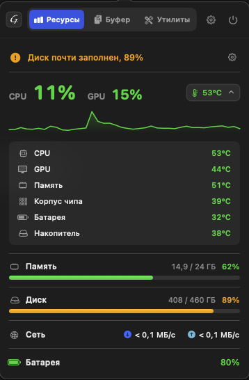
  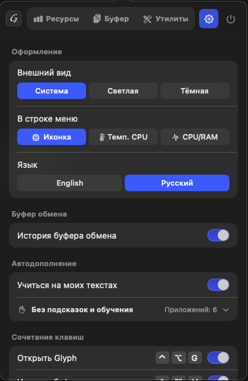
  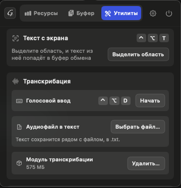
</p>

### Что умеет

#### Ресурсы

CPU, GPU, память, диск, сеть, батарея и температуры датчиков. В строке меню можно
оставить иконку или выводить температуру CPU либо загрузку CPU и RAM.

#### Буфер обмена

Последние 10 скопированных элементов: текст, ссылки, файлы, картинки до 30 МБ. История
хранится только в памяти и открывается из любого приложения по `Ctrl+Opt+V`.

<p align="center">
  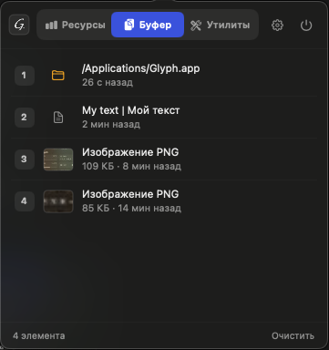
</p>

#### Автодополнение

Glyph дописывает слово серым прямо в поле ввода любого приложения, `Tab` вставляет
подсказку. Словарь для русского и английского есть с первого запуска, со временем он
подстраивается под ваш текст. На Mac с Apple silicon можно включить умные подсказки:
их добавляет небольшая языковая модель (модуль 347 МБ).

<p align="center">
  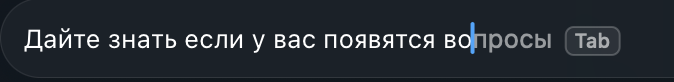
</p>
<p align="center">
  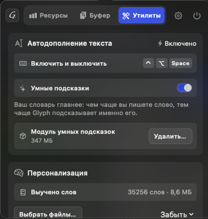
</p>

#### Голосовой ввод

Нажмите `Ctrl+Opt+D`, говорите, нажмите ещё раз, и текст со знаками препинания
появится в поле. Аудиофайл можно перевести в .txt. Для этого нужен модуль распознавания
речи (575 МБ), он скачивается один раз во вкладке «Утилиты».

<p align="center">
  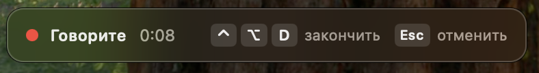
</p>

#### Текст с экрана

`Ctrl+Opt+T`, выделите область, и текст с неё окажется в буфере обмена.

#### Виджет

CPU, память, сеть и батарея на рабочем столе или в Центре уведомлений.

<p align="center">
  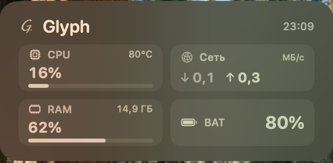
</p>

### Установка

Нужна macOS 14 Sonoma или новее.

1. Скачайте `Glyph-<версия>.dmg` со страницы
   [Releases](https://github.com/GV-Echo/Glyph-releases/releases/latest), откройте его и
   перетащите Glyph в «Программы».
2. Glyph не нотаризован Apple, и при первом запуске macOS его заблокирует. Разрешите
   запуск в Терминале:

   ```bash
   xattr -dr com.apple.quarantine /Applications/Glyph.app && open /Applications/Glyph.app
   ```

   Или через Системные настройки → Конфиденциальность и безопасность → «Открыть всё равно».
3. Значок появится в строке меню, в Dock его нет. Для автодополнения дайте Glyph доступ в
   разделе Конфиденциальность и безопасность → Универсальный доступ.

Дальше Glyph раз в день сам проверяет обновления.

### Приватность

- В сеть Glyph выходит только за обновлениями и за модулями, которые вы скачиваете сами.
- История буфера не пишется на диск и в логи. Пароли из менеджеров паролей в неё не
  попадают.
- Обучение выключено по умолчанию. Если его включить, Glyph хранит счётчики слов, а не
  текст, в зашифрованном файле. На полях паролей и в приложениях из списка исключений он
  не учится. Выученное можно забыть за последние 7 или 30 дней или целиком.
- Запись голоса при диктовке держится только в оперативной памяти и не пишется на диск.

### Сочетания клавиш

| Сочетание | Действие |
|---|---|
| `Ctrl+Opt+G` | Открыть или закрыть Glyph |
| `Ctrl+Opt+V` | Буфер обмена |
| `Ctrl+Opt+Space` | Включить или выключить автодополнение |
| `Tab`, `Esc` | Принять или скрыть подсказку |
| `Ctrl+Opt+D` | Голосовой ввод |
| `Ctrl+Opt+T` | Текст с экрана |
| `Cmd+1`, `Cmd+2`, `Cmd+3`, `Cmd+,` | Ресурсы, буфер, утилиты, настройки |

### Как устроен

- Swift, AppKit и SwiftUI, виджет на WidgetKit.
- Показатели читаются через Mach, IOKit и sysctl, температуры из SMC.
- Автодополнение видит поле ввода через Accessibility. Подсказки строятся по частотному
  словарю слов и сочетаний, умные подсказки дополняет Qwen3-0.6B на MLX.
- Речь распознаёт whisper.cpp на GPU (Metal), текст с экрана читает Apple Vision.
- Обновления подписаны ключом Ed25519. Glyph ставит обновление, только если подпись
  верна и новая сборка подписана тем же сертификатом.
- Сторонний код: whisper.cpp и MLX Swift под лицензией MIT. Полный список в «О программе
  Glyph» → «Лицензии».

---

## English

Glyph is a small macOS menu-bar utility. It shows how busy your Mac is, remembers what
you copied recently, suggests words as you type and turns speech into text. It all runs
on the Mac: your text and voice are never sent anywhere.

<p align="center">
  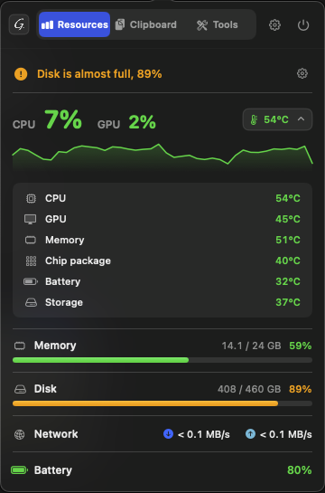
  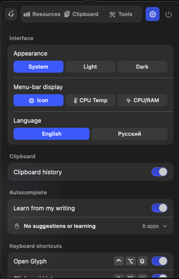
  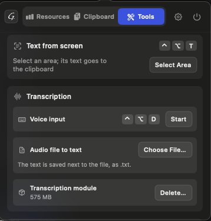
</p>

### What it does

#### Resources

CPU, GPU, memory, disk, network, battery and sensor temperatures. The menu bar can show
the icon, the CPU temperature or CPU and RAM load.

#### Clipboard

The last 10 things you copied: text, links, files, images up to 30 MB. The history lives
in memory only and opens from any app with `Ctrl+Opt+V`.

<p align="center">
  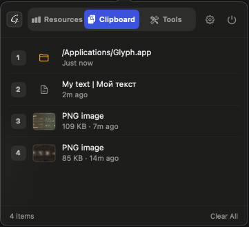
</p>

#### Autocomplete

Glyph finishes the word in grey right in the text field of any app, and `Tab` inserts it.
Russian and English vocabularies work from the first launch and adapt to your writing
over time. On Apple silicon you can turn on smart suggestions from a small language
model (a 347 MB module).

<p align="center">
  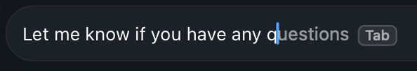
</p>
<p align="center">
  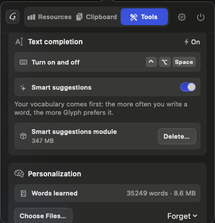
</p>

#### Voice input

Press `Ctrl+Opt+D`, speak, press it again, and the text appears in the field with
punctuation. Audio files can be turned into .txt too. This needs the speech recognition
module (575 MB), downloaded once from the Tools tab.

<p align="center">
  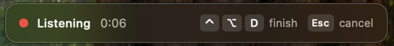
</p>

#### Text from screen

`Ctrl+Opt+T`, select an area, and its text lands on the clipboard.

#### Widget

CPU, memory, network and battery on the desktop or in Notification Center.

<p align="center">
  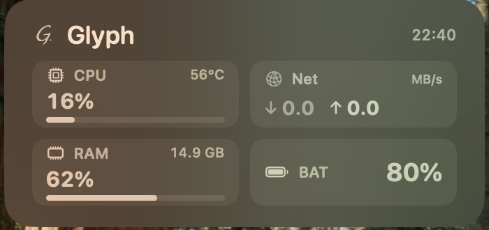
</p>

### Install

Requires macOS 14 Sonoma or newer.

1. Download `Glyph-<version>.dmg` from
   [Releases](https://github.com/GV-Echo/Glyph-releases/releases/latest), open it and drag
   Glyph into Applications.
2. Glyph is not notarized by Apple, so macOS blocks the first launch. Allow it in Terminal:

   ```bash
   xattr -dr com.apple.quarantine /Applications/Glyph.app && open /Applications/Glyph.app
   ```

   Or use System Settings → Privacy & Security → "Open Anyway".
3. The icon appears in the menu bar; there is no Dock icon. For autocomplete, allow Glyph
   in Privacy & Security → Accessibility.

After that Glyph checks for updates once a day.

### Privacy

- Glyph goes online only for updates and for modules you download yourself.
- Clipboard history never reaches the disk or the logs. Passwords from password managers
  are not recorded.
- Learning is off by default. When it is on, Glyph keeps word counts, not your text, in an
  encrypted file. It never learns from password fields or from apps on the exclusion list.
  You can forget the last 7 or 30 days, or everything.
- Dictated voice stays in RAM only and never reaches the disk.

### Shortcuts

| Shortcut | Action |
|---|---|
| `Ctrl+Opt+G` | Open or close Glyph |
| `Ctrl+Opt+V` | Clipboard |
| `Ctrl+Opt+Space` | Turn autocomplete on or off |
| `Tab`, `Esc` | Accept or dismiss a suggestion |
| `Ctrl+Opt+D` | Voice input |
| `Ctrl+Opt+T` | Text from screen |
| `Cmd+1`, `Cmd+2`, `Cmd+3`, `Cmd+,` | Resources, Clipboard, Tools, Settings |

### How it works

- Swift, AppKit and SwiftUI, with a WidgetKit widget.
- Metrics come from Mach, IOKit and sysctl, temperatures from the SMC.
- Autocomplete reads the text field through Accessibility. Suggestions come from a
  frequency table of words and word sequences; smart suggestions add Qwen3-0.6B on MLX.
- whisper.cpp recognises speech on the GPU (Metal), Apple Vision reads text from the screen.
- Updates are signed with an Ed25519 key. Glyph installs one only if the signature checks
  out and the new build is signed with the same certificate.
- Third-party code: whisper.cpp and MLX Swift, MIT licence. The full list is in About
  Glyph → Licences.
